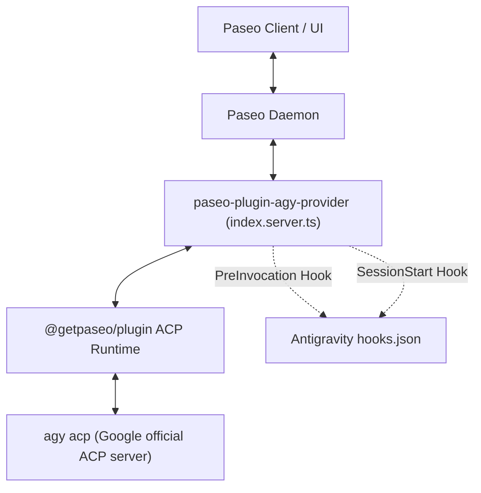

# Design

This document records the architectural design implemented in `paseo-plugin-agy-provider` to integrate Google's official Antigravity ACP server (`agy acp`) into Paseo.

---

## Architecture Overview



Paseo communicates with agent providers using the Paseo Provider Protocol (version 1). Rather than spawning the `agy` CLI in headless `stream-json` mode (which requires `--dangerously-skip-permissions`), this plugin drives Google's official Agent Client Protocol (ACP) server via `agy acp`.

Because the Antigravity ACP server is an external, Google-managed binary with its own lifecycle and protocol quirks, several workarounds bridge the differences between Paseo's expectations and Antigravity's behavior.

---

## Inventory of Workarounds

### 1. System Prompt Injection & Timeline Sanitization

- **Root Cause**:
  Paseo passes `ProviderSessionConfig.systemPrompt` under `params._meta._paseo.systemPrompt` when calling `session/new` or `session/load`. While `agy_acp_server` 1.4.0 supports system instructions natively, it strictly expects them under `params._meta.antigravity.systemPrompt.append` via `system_prompt.py`. Older server builds (such as 1.1.1) ignored instructions entirely. Because Paseo's ACP runner hardcodes `_meta._paseo`, Paseo's instructions never reached Antigravity.
- **Implementation** ([index.server.ts](index.server.ts)):
  1. On `session.open`, the plugin captures `input.config.systemPrompt`.
  2. On the first user `session.prompt` (excluding steering prompts), the plugin prepends `${systemPrompt}\n\n` to the message text before passing it to `connection.send()`.
  3. When Paseo's ACP runner echoes the prompt back as a `user_message` timeline event, `onEvent` intercepts the event, strips the prepended system prompt, and emits only the clean, original user prompt to the UI.
  4. Subsequent prompts within the session are forwarded without modification.
- **Status**: Implemented in-plugin. Completely transparent to the user UI.

---

### 2. Turn Steering via Antigravity PreInvocation Hook

- **Root Cause**:
  Paseo supports mid-turn "steering" (`delivery: "steer"`): injecting user guidance while an agent is thinking or running tools. While the native `agy acp` Go server implements mid-turn steering (`canSteerActiveTurn`, `waitForSteer`, `finishSteer` in its turn loop), Paseo's client-side ACP runtime (`@getpaseo/plugin/server/acp`, specifically `AcpSessionRuntime.admitPrompt`) does not support concurrent prompts. If an active prompt is in flight, `admitPrompt` unconditionally executes:
  ```js
  if (active) {
      await this.interrupt(); // sends session/cancel to agy acp
      await active.settled;
  }
  ```
  Forwarding a steer prompt directly to Paseo's ACP connection during an active turn would therefore cause Paseo's ACP runtime to cancel the running turn in `agy acp` and start a separate turn. Because `runAcpProvider` wraps the transport and does not expose raw stdio JSON-RPC calls or advertise `prompt.steer`, the plugin cannot bypass `admitPrompt` directly.
- **Implementation** ([server/steer.ts](server/steer.ts), [index.server.ts](index.server.ts)):
  1. The plugin registers a global Antigravity `PreInvocation` command hook in `~/.gemini/config/hooks.json`.
  2. When a `session.prompt` with `delivery: "steer"` arrives for an active turn, the plugin intercepts it in `index.server.ts` before it reaches Paseo's ACP runtime.
  3. The plugin writes the message to a file-backed FIFO queue keyed by conversation ID (`~/.gemini/antigravity-cli/steer/<conversation-id>/`).
  4. The plugin immediately emits synthetic `timeline.item` (`user_message`) and `session.prompt_result` (`type: "steer"`) events so the message appears in the chat immediately without interrupting the running turn.
  5. Before each model invocation within the turn, Antigravity executes the `PreInvocation` hook, which drains one queued message from disk and injects it directly into the agent's context as an injected user step.
  6. If no turn is active when the steer arrives (or the turn ended before delivery), the message degrades safely to a regular prompt (`delivery: "auto"`).
  7. The hook is removed on plugin teardown.
- **Upstream Path to Native Steering**:
  To eliminate the `PreInvocation` hook and the filesystem queue, Paseo's upstream `AcpSessionRuntime.admitPrompt` in `@getpaseo/plugin` must support `delivery: "steer"` by bypassing `this.interrupt()` and dispatching `session/prompt` directly to the active session. Once that lands, the plugin can remove `server/steer.ts` and forward steer prompts natively to `agy acp`.
- **Status**: Implemented. Advertises `prompt.steer` capability.

---

### 3. Progress Narration via SessionStart Hook

- **Root Cause**:
  Paseo provides a progress view to follow long-running agent workflows, but Antigravity sessions do not output structured step narration by default.
- **Implementation** ([server/progress.ts](server/progress.ts), [index.server.ts](index.server.ts)):
  1. The plugin registers a global `SessionStart` hook in `~/.gemini/config/hooks.json`.
  2. To avoid affecting non-Paseo Antigravity CLI sessions, `server.before("agent.session_open")` injects `PASEO_AGY_PROGRESS: "1"` into the session environment.
  3. When `PASEO_AGY_PROGRESS === "1"`, the hook injects narration guidelines instructing the agent to report milestone progress.
  4. The hook is removed on plugin teardown.
- **Status**: Implemented.

---

### 4. Multi-Source MCP Discovery and Viability Preflight

- **Root Cause**:
  Antigravity users configure MCP servers in several locations:
  - Global: `~/.gemini/config/mcp_config.json`
  - Workspace / repository: `.agents/mcp_config.json` (walking up from `cwd` to repository root)
  - Paseo workspace configuration
  If any configured MCP server fails to start (e.g., missing binary or network failure), `agy_acp_server` can fail or brick the entire session.
- **Implementation** ([server/mcp.ts](server/mcp.ts)):
  1. `resolveMcpServers()` discovers and merges MCP servers across all sources with strict precedence (nearest repository configuration overrides global; explicit Paseo config takes precedence).
  2. `filterViableMcpServers()` runs preflight probes against stdio commands (`probeStdioServer`) and HTTP/SSE endpoints (`probeHttpServer`).
  3. Non-viable servers are filtered out before passing `mcpServers` to `session.open`, emitting a warning instead of failing session startup.
- **Status**: Implemented.

---

### 5. API Quota Exhaustion Interception

- **Root Cause**:
  When Gemini API rate limits or quota limits are exceeded, Antigravity outputs the error as standard assistant text or thought blocks (e.g. `"You have reached your current quota for this period..."`) and completes the turn normally. Paseo would mark the turn as successful, confusing users.
- **Implementation** ([server/quota.ts](server/quota.ts), [index.server.ts](index.server.ts)):
  1. `isQuotaExceededErrorMessage()` detects quota exhaustion strings in `assistant_message` and `reasoning` timeline items.
  2. The message is suppressed from the timeline and buffered in `pendingQuotaErrors`.
  3. When `session.turn` completes or cancels, the plugin converts the turn state to `state: "failed"` with `code: "quota_exhausted"` and a clean, formatted error message.
- **Status**: Implemented.

---

### 6. MCP Initialization Error Suppression & Turn Failure

- **Root Cause**:
  If an MCP server fails to initialize at runtime, `agy_acp_server` streams verbose ANSI-colored errors into the assistant transcript before completing or failing.
- **Implementation** ([server/mcp.ts](server/mcp.ts), [index.server.ts](index.server.ts)):
  1. `isMcpInitializationErrorMessage()` detects runtime MCP failure output.
  2. Strips ANSI escape codes, logs the warning to daemon logs, and suppresses the ugly error chunk from the chat timeline.
  3. When the turn concludes, settles the turn as `failed` with code `mcp_initialization_failed`.
- **Status**: Implemented.

---

### 7. Tool Call Timeline Detail Enrichment

- **Root Cause**:
  ACP tool calls arrive with generic details (`type: "unknown"`), missing the semantic categorization Paseo uses to render dedicated UI blocks (shell terminals, diff viewers, subagent cards, web search results).
- **Implementation** ([server/tools.ts](server/tools.ts)):
  1. Parses both camelCase and snake_case parameters from Antigravity tools.
  2. Maps `run_command` -> `type: "shell"` (with `command`, `cwd`, `output`, `exitCode`).
  3. Maps `view_file` / `read_file` -> `type: "read"` (with line ranges).
  4. Maps `write_to_file` -> `type: "write"` and edit tools -> `type: "edit"`.
  5. Maps `search_web` -> `type: "search"`.
  6. Maps `read_url_content` -> `type: "fetch"`.
  7. Maps `invoke_subagent` -> `type: "sub_agent"` (extracting `TypeName` and `Prompt`).
  8. Sanitizes failed tool calls with `error: null` by extracting error text from output.
- **Status**: Implemented.

---

### 8. Fallback CWD for Root and Missing Directories

- **Root Cause**:
  Sending `cwd: "/"` or omitting `cwd` during `catalog` discovery or `sessions` listing causes file inspection failures on certain platforms.
- **Implementation** ([index.server.ts](index.server.ts)):
  Falls back to `homedir()` when `input.cwd` is empty or `"/"`.
- **Status**: Implemented.

---

### 9. Transparent ACP Session Recovery on Session Disconnect

- **Root Cause**:
  If an ACP worker process disconnects or fails during a turn (`Session not found`, `Internal error`, or unexpected transport closure), subsequent requests to that worker fail even though the underlying SQLite trajectory (`<sessionId>.db`) on disk is intact.
- **Implementation** ([server/recovery.ts](server/recovery.ts), [index.server.ts](index.server.ts)):
  1. The plugin records each session's `session.open` snapshot, tracks `session.configure` and `session.config` updates (such as model switches), captures the native ACP `persistence` (`{ sessionId }`), and stores the in-flight `session.prompt` payload for the active turn.
  2. When `isRecoverableTurnFailureMessage()` detects a recoverable turn failure (`Session not found`, `Internal error`, or transport closure), the plugin initiates recovery instead of dropping the conversation.
  3. The plugin sends `session.close` followed by `session.open` (`history: "skip"`, passing `persistence` and the current `config`) so Paseo's ACP connection spawns a fresh worker via `session/load`, and then replays the interrupted `session.prompt` within the same Paseo turn.
  4. If the session cannot be reopened or fails again on replay, the turn is settled as `failed` with `error.code: "connection_lost"`.
- **Status**: Implemented.

---

### 10. Dangerously Skip Permissions Mode

- **Root Cause**:
  While the legacy standalone `agy_acp_server.par` advertised a native `yolo` mode ("Auto-approve all tools"), the built-in `agy acp` server in the official `agy` CLI only advertises `default`, `accept-edits`, and `plan`. Attempting to set `mode: "yolo"` or `mode: "dangerously-skip-permissions"` directly via ACP `session/set_mode` results in JSON-RPC error `-32602: Unknown mode`. However, `agy acp` accepts a `--dangerously-skip-permissions` CLI flag, and Paseo users need an interactive mode option in the mode selector to skip tool permission prompts during unattended or trusted workflows.
- **Implementation** ([server/modes.ts](server/modes.ts), [index.server.ts](index.server.ts)):
  1. The plugin defines `DANGEROUSLY_SKIP_PERMISSIONS_MODE` (`id: "dangerously-skip-permissions"`, `label: "Dangerously skip permissions"`, `icon: "ShieldOff"`, `colorTier: "dangerous"`, `isUnattended: true`) and advertises it in `catalog.modes` and `session.config.modes`. The legacy `yolo` mode ID is also recognized as an alias.
  2. When a session is opened or configured in this mode, the plugin records the session's active mode in `sessionModes` and translates the mode sent to the underlying `agy acp` server to `accept-edits` (so native file edits require no prompts).
  3. When `session.permission` events arrive from `agy acp` (for commands, terminal executions, etc.) for a session in this mode, the plugin intercepts the event, suppresses it from reaching the Paseo UI, and immediately replies with `behavior: "allow"`. The corresponding `session.permission_resolved` event is also suppressed.
  4. The mode is preserved across transparent session recoveries.
  5. Setting `PASEO_AGY_DANGEROUSLY_SKIP_PERMISSIONS="1"` in the daemon environment passes `--dangerously-skip-permissions` directly to `agy acp` for server-wide auto-approval.
- **Status**: Implemented.
