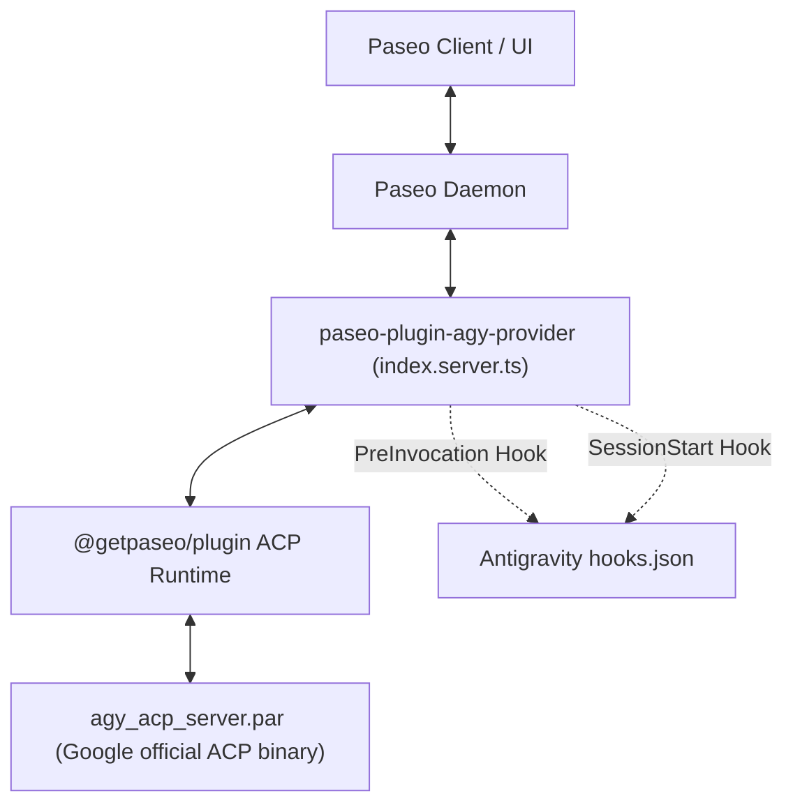

# Design

This document records the architectural design implemented in `paseo-plugin-agy-provider` to integrate Google's official Antigravity ACP server (`agy_acp_server`) into Paseo.

---

## Architecture Overview

Paseo communicates with agent providers using the Paseo Provider Protocol (version 1). Rather than spawning the `agy` CLI in headless `stream-json` mode (which requires `--dangerously-skip-permissions`), this plugin drives Google's official Agent Client Protocol (ACP) binary (`agy_acp_server.par` / `agy_acp_server.exe`).

Because `agy_acp_server` is an external, Google-managed binary with its own lifecycle and protocol quirks, several workarounds bridge the differences between Paseo's expectations and Antigravity's behavior.

---

## Inventory of Workarounds

### 1. System Prompt Injection & Timeline Sanitization

- **Root Cause**:
  Paseo passes `ProviderSessionConfig.systemPrompt` under `params._meta._paseo.systemPrompt` when calling `session/new` or `session/load`. While `agy_acp_server` 1.4.0 supports system instructions natively, it strictly expects them under `params._meta.antigravity.systemPrompt.append` via `system_prompt.py`. Older server builds (such as 1.1.1) ignored instructions entirely. Because Paseo's ACP runner hardcodes `_meta._paseo`, Paseo's instructions never reached Antigravity.
- **Implementation** ([index.server.ts](index.server.ts)):
  1. On `session.open`, the plugin captures `input.config.systemPrompt`.
  2. On the first user `session.prompt` (excluding steering prompts), the plugin prepends `${systemPrompt}\n\n` to the message text before passing it to `connection.send()`.
  3. When Paseo's ACP runner echoes the prompt back as a `user_message` timeline event, `onEvent` intercepts the event, strips the prepended system prompt, and emits only the clean, original user prompt to the UI.
  4. Subsequent prompts within the session are forwarded without modification.
- **Status**: Implemented in-plugin. Completely transparent to the user UI.

---

### 2. Turn Steering via Antigravity PreInvocation Hook

- **Root Cause**:
  Paseo supports mid-turn "steering" (`delivery: "steer"`): injecting guidance while an agent is thinking or executing tools. However, Antigravity ACP only reads prompts between turns; sending an ACP `session/prompt` while a turn is active causes the ACP adapter to interrupt the turn and restart.
- **Implementation** ([server/steer.ts](server/steer.ts), [index.server.ts](index.server.ts)):
  1. The plugin registers a global Antigravity `PreInvocation` command hook in `~/.gemini/config/hooks.json`.
  2. When a steer prompt arrives for an active turn, instead of forwarding it over ACP, the plugin writes the message to a file-backed FIFO queue keyed by conversation ID (`~/.gemini/antigravity-cli/steer/<conversation-id>/`).
  3. The plugin immediately emits synthetic `timeline.item` (`user_message`) and `session.prompt_result` (`type: "steer"`) events so the message appears in the chat immediately.
  4. Before each model invocation within the turn, Antigravity executes the `PreInvocation` hook, which drains one queued message from disk and injects it directly into the agent's context.
  5. If no turn is active when the steer arrives, it degrades safely to a regular prompt (`delivery: "auto"`).
  6. The hook is removed on plugin teardown.
- **Status**: Implemented. Advertises `prompt.steer` capability.

---

### 3. Progress Narration via SessionStart Hook

- **Root Cause**:
  Paseo provides a progress view to follow long-running agent workflows, but Antigravity sessions do not output structured step narration by default.
- **Implementation** ([server/progress.ts](server/progress.ts), [index.server.ts](index.server.ts)):
  1. The plugin registers a global `SessionStart` hook in `~/.gemini/config/hooks.json`.
  2. To avoid affecting non-Paseo Antigravity CLI sessions, `server.before("agent.session_open")` injects `PASEO_AGY_PROGRESS: "1"` into the session environment.
  3. When `PASEO_AGY_PROGRESS === "1"`, the hook injects narration guidelines instructing the agent to report milestone progress.
  4. The hook is removed on plugin teardown.
- **Status**: Implemented.

---

### 4. Multi-Source MCP Discovery and Viability Preflight

- **Root Cause**:
  Antigravity users configure MCP servers in several locations:
  - Global: `~/.gemini/config/mcp_config.json`
  - Workspace / repository: `.agents/mcp_config.json` (walking up from `cwd` to repository root)
  - Paseo workspace configuration
  If any configured MCP server fails to start (e.g., missing binary or network failure), `agy_acp_server` can fail or brick the entire session.
- **Implementation** ([server/mcp.ts](server/mcp.ts)):
  1. `resolveMcpServers()` discovers and merges MCP servers across all sources with strict precedence (nearest repository configuration overrides global; explicit Paseo config takes precedence).
  2. `filterViableMcpServers()` runs preflight probes against stdio commands (`probeStdioServer`) and HTTP/SSE endpoints (`probeHttpServer`).
  3. Non-viable servers are filtered out before passing `mcpServers` to `session.open`, emitting a warning instead of failing session startup.
- **Status**: Implemented.

---

### 5. API Quota Exhaustion Interception

- **Root Cause**:
  When Gemini API rate limits or quota limits are exceeded, Antigravity outputs the error as standard assistant text or thought blocks (e.g. `"You have reached your current quota for this period..."`) and completes the turn normally. Paseo would mark the turn as successful, confusing users.
- **Implementation** ([server/quota.ts](server/quota.ts), [index.server.ts](index.server.ts)):
  1. `isQuotaExceededErrorMessage()` detects quota exhaustion strings in `assistant_message` and `reasoning` timeline items.
  2. The message is suppressed from the timeline and buffered in `pendingQuotaErrors`.
  3. When `session.turn` completes or cancels, the plugin converts the turn state to `state: "failed"` with `code: "quota_exhausted"` and a clean, formatted error message.
- **Status**: Implemented.

---

### 6. MCP Initialization Error Suppression & Turn Failure

- **Root Cause**:
  If an MCP server fails to initialize at runtime, `agy_acp_server` streams verbose ANSI-colored errors into the assistant transcript before completing or failing.
- **Implementation** ([server/mcp.ts](server/mcp.ts), [index.server.ts](index.server.ts)):
  1. `isMcpInitializationErrorMessage()` detects runtime MCP failure output.
  2. Strips ANSI escape codes, logs the warning to daemon logs, and suppresses the ugly error chunk from the chat timeline.
  3. When the turn concludes, settles the turn as `failed` with code `mcp_initialization_failed`.
- **Status**: Implemented.

---

### 7. Tool Call Timeline Detail Enrichment

- **Root Cause**:
  ACP tool calls arrive with generic details (`type: "unknown"`), missing the semantic categorization Paseo uses to render dedicated UI blocks (shell terminals, diff viewers, subagent cards, web search results).
- **Implementation** ([server/tools.ts](server/tools.ts)):
  1. Parses both camelCase and snake_case parameters from Antigravity tools.
  2. Maps `run_command` -> `type: "shell"` (with `command`, `cwd`, `output`, `exitCode`).
  3. Maps `view_file` / `read_file` -> `type: "read"` (with line ranges).
  4. Maps `write_to_file` -> `type: "write"` and edit tools -> `type: "edit"`.
  5. Maps `search_web` -> `type: "search"`.
  6. Maps `read_url_content` -> `type: "fetch"`.
  7. Maps `invoke_subagent` -> `type: "sub_agent"` (extracting `TypeName` and `Prompt`).
  8. Sanitizes failed tool calls with `error: null` by extracting error text from output.
- **Status**: Implemented.

---

### 8. Fallback CWD for Root and Missing Directories

- **Root Cause**:
  Sending `cwd: "/"` or omitting `cwd` during `catalog` discovery or `sessions` listing causes file inspection failures on certain platforms.
- **Implementation** ([index.server.ts](index.server.ts)):
  Falls back to `homedir()` when `input.cwd` is empty or `"/"`.
- **Status**: Implemented.
